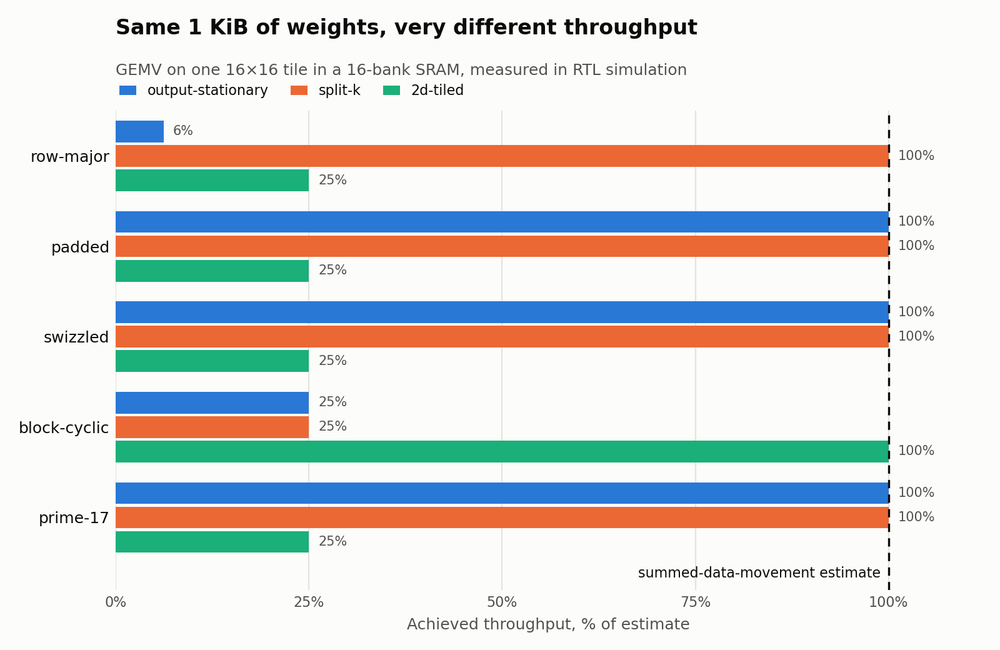
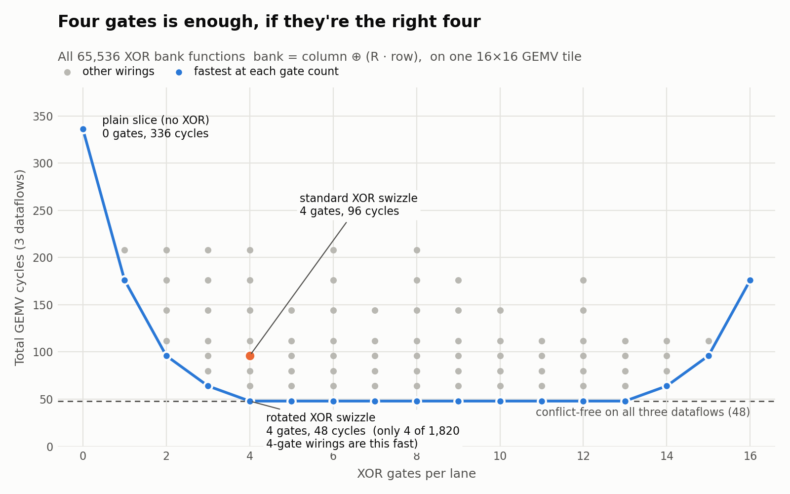

# Same bytes, different time

Hardware performance models like [Timeloop](https://timeloop.csail.mit.edu/) and
[Interstellar](https://arxiv.org/abs/1809.04070) estimate how fast a memory level is by counting how much
data moves through it and dividing by its bandwidth. That works until the memory is split into banks. Then
*where* the data sits matters as much as *how much* of it there is.

This repo is a small Verilog model that shows the gap: reading the same 1 KiB of weights for a GEMV can take
anywhere from 16 to 256 cycles, depending only on the data layout and the loop order. A byte-counting model
says 16 every time.


<sub>[Full-quality video](docs/same_data.mp4)</sub>

## The setup, briefly

On-chip SRAM in accelerators and GPUs (shared memory on NVIDIA, for example) isn't one big array. It's split
into banks, here 16, and each bank can return one word per cycle. When 16 lanes read at once, the read
finishes in one cycle if every lane hits a different bank. If they pile onto the same bank, that bank serves
them one at a time.

Which bank a word lands in is a fixed function of its address, usually just the low address bits. So the
software decides how bad a read is, through two choices:

- **Layout**: where each element of the matrix lives in memory (row-major, padded, swizzled, ...).
- **Dataflow**: which elements the lanes read together, which follows from how the loop is split across them.

Reading a column of a row-major 16×16 tile is the classic bad case. Every element in a column has the same low
address bits, so all 16 reads go to one bank and take 16 cycles.

## What's modeled

A 16-lane, 16-bank scratchpad in SystemVerilog, with a per-bank arbiter that counts cycles until every lane
has its data. Each layout is a small bank-select function in [`rtl/bank_select.sv`](rtl/bank_select.sv), and
every result below is checked against a Python reference model.

## Results

**Single reads.** Cycles for one 16-lane read of a 16×16 tile. 1 is ideal and 16 is fully serialized.

|              | row | column | diagonal | anti-diag | 4×4 block |
|--------------|----:|-------:|---------:|----------:|----------:|
| row-major    | 1 | **16** | 1 | 1 | 4 |
| padded       | 1 | 1 | 2 | **16** | 4 |
| swizzled     | 1 | 1 | **16** | **16** | 4 |
| block-cyclic | 4 | 4 | 4 | 4 | 1 |
| prime-17     | 1 | 1 | **16** | 1 | 4 |
| rotated-xor  | 1 | 1 | 4 | 4 | 1 |

Each fix trades one bad pattern for another. That's unavoidable: each bank holds 1/16 of the cells, so
some set of 16 cells always shares a bank.

**GEMV.** One 16×16 weight tile, read with three common ways of splitting the work across lanes:

- **output-stationary**: lane *i* computes `y[i]`, so each step reads a column.
- **split-k**: the lanes share each output, so each step reads a row.
- **2d-tiled**: each step reads one 4×4 block.

All three read the same 256 words, so a byte-counting estimate gives 256 / 16 = 16 cycles for every bar below.



The worst case is output-stationary on row-major: 256 cycles, 6% of the estimate. That's also the mapping a
cost model is likely to like, since it keeps partial sums inside each lane. (I didn't run Timeloop's mapper to
confirm that. The estimate here is its bandwidth formula, worked out by hand.)

**Searching for a better swizzle.** The XOR swizzle has a free choice: which row bits get mixed into which
bank bits. [`xor_search.py`](xor_search.py) tries all 65,536 wirings and scores each on the three GEMV
dataflows.



You need at least 4 XOR gates to make all three dataflows conflict-free. The standard swizzle uses 4 but
still conflicts on 4×4 blocks. Rotating which row bits it uses fixes that at the same cost, and only 4 of the
1,820 four-gate wirings manage it. That rotated version is in the RTL as `rotated-xor`. Libraries like CUTLASS
already make this choice configurable, so this isn't a new technique, just a measurement of how much the
choice matters for this workload.

**Hardware cost** (Yosys generic gates, logic only, no storage):

| Block | Gates |
|---|---:|
| bank select: slice, block-cyclic | 0 |
| bank select: XOR, rotated XOR | 4 per lane |
| bank select: mod 17 | 83 per lane |
| arbiter, 16 banks | 1,127 |
| arbiter, 17 banks | 1,234 |

The swizzle costs 4 gates per lane next to an arbiter of about 1,100. Mod 17 is about 20× the swizzle, which
is why prime bank counts are rare in practice.

## Running it

Needs Icarus Verilog, Yosys, and Python 3 with matplotlib (`brew install icarus-verilog yosys`).

```sh
python3 run.py && ./synth.sh && python3 compare.py && python3 xor_search.py
```

## Limitations

- It's one tile and one SRAM level. No DRAM or interconnect, and no overlap between consecutive reads.
- The arbiter is the simplest one possible: fixed priority, one read in flight. Real memory pipelines have
  queues that can hide some of this.
- The comparison is against the byte-counting formula, not a full Timeloop run.
- Gate counts use Yosys's generic library, so they're relative costs, not area in a real process.

## Acknowledgments

I used Claude to write code for this project and to generate the animation.
